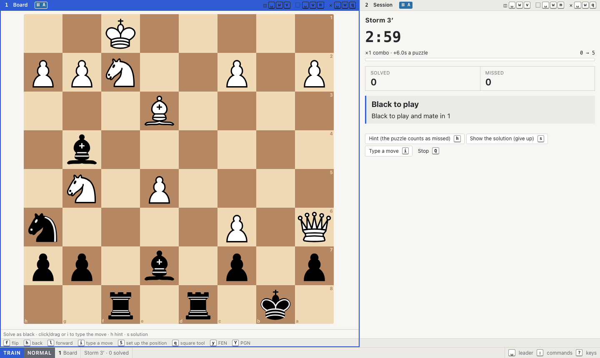
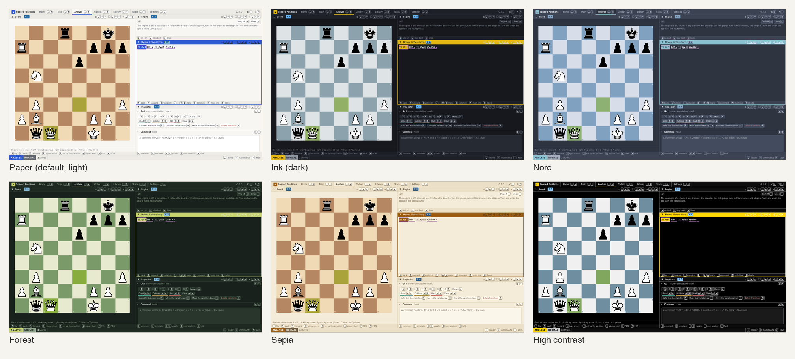
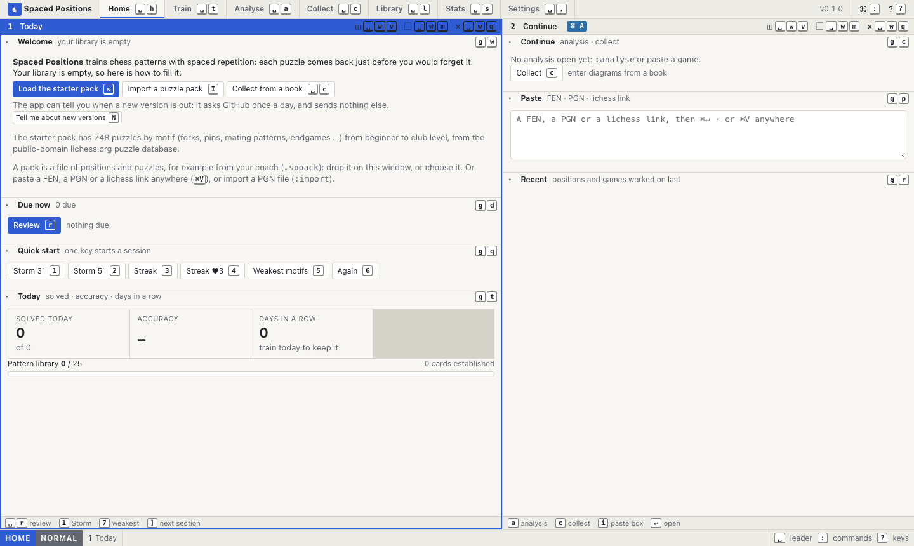
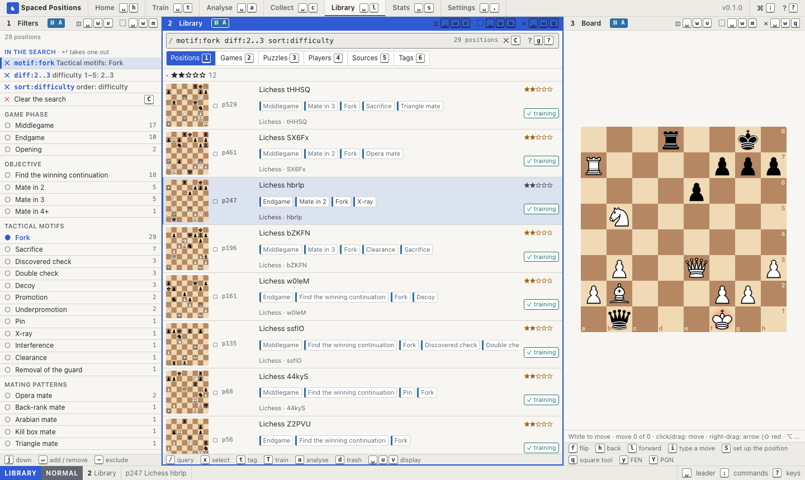

# Spaced Positions

**Stop forgetting the tactics you have already solved.**

You solve a puzzle, you understand the idea, and three weeks later the same knight fork costs you a game. Spaced
Positions fixes that. It brings every puzzle back **just before you would forget it**: a miss soon, a solve later and
later. The patterns move from "I've seen this" to "I just see it".

It is free, it runs on your own computer, and it works without an account or an internet connection. You can start in
five minutes with 748 hand-picked puzzles, and you can add the puzzles from your own chess books.



## Why you'll like it

- **Training that remembers for you.** No decks to manage, no "how well did you know this?" buttons. Solve or
  miss; the app works out when you see the puzzle again. A short session a day keeps hundreds of patterns sharp.
- **Your books, finally trainable.** Collect the diagrams from the books on your shelf: set up the position, save, and
  the page and diagram number count up by themselves. Every puzzle keeps its source, so you always know where it came
  from.
- **More than one way to train.** *Review* for the puzzles that are due, *Storm* against the clock with combos,
  *Streak* until your first mistake (also with lives, or blindfold), your *weakest motifs*, or any selection you like.
- **A real analysis board.** A move tree like in a book, comments, symbols, arrows, and Stockfish built in. Turn any
  position of a game into a puzzle with two keys.
- **See yourself improve.** Which motifs you master, which you keep missing, how much you remember, your records.
  Every number leads to the puzzles behind it.
- **For coaches and their students.** Put puzzles into a pack file and give it to your students; they train it in
  their own copy, and a newer version of the pack keeps their progress.
- **Private by design.** Everything stays on your computer. Nothing is sent anywhere unless you switch on the update
  check.
- **In your language.** English, Deutsch, Français, Italiano.

## Make it yours

Six themes come with it, from the calm default *Paper* to dark *Ink* and *Nord*, green *Forest*, warm *Sepia* and
*High contrast*. *Automatic* follows your computer's light or dark mode.



- **Try them live:** in Settings, move through the themes with the arrow keys and the whole app changes as you go;
  `Enter` keeps one. `space` `u` `t` switches between a theme's light and dark version.
- **12 piece sets** (`space` `u` `p`), board colours, fonts, sizes and spacing: every colour and size is a setting.
  **Save as my theme** keeps your mix, and you can copy it to share it.
- **Coordinates** inside or outside the board, **piece letters** in your language (KDTLS, RDTFC, RDTAC), figurines in
  the move list, sounds on or off.

## Get started in five minutes

### 1. Download

Get the app from the [releases page](https://github.com/Piscary/SpacedPositions/releases): the newest version is at
the top, under *Assets*.

- **Mac with Apple Silicon** (M1, M2, … : Apple menu → *About This Mac* says "Chip Apple M…"): download
  `…-macOS-AppleSilicon.dmg`.
- **Mac with Intel** (*About This Mac* says "Processor … Intel"): download `…-macOS-Intel.dmg`.
- **Windows:** download `…-Windows.zip`.

On a Mac, open the `.dmg` and drag **Spaced Positions** into *Applications*. On Windows, unzip the file (right click →
*Extract All*) and open the folder.

The app is not signed yet (signing costs money every year), so your computer asks once whether you trust it:

- **macOS 15 and newer:** double-click the app; macOS says it can't check it. Open *System Settings* → *Privacy &
  Security*, scroll down, and click *Open Anyway* next to "Spaced Positions". After that, a normal double click works.
- **Older macOS:** right click the app → *Open* → *Open*.
- **Windows:** if a blue window says "Windows protected your PC", click *More info* → *Run anyway*.

*Nightly* is a pre-release built from the newest code, for testers: it may have bugs. Your data stays when you
switch between versions.

### 2. Start it

Double-click **Spaced Positions** (on Windows: `Spaced Positions.exe` in the folder). It opens in your web browser,
like a website, but it runs entirely on your computer. Close the browser tab when you are done: the app stops by
itself ten minutes later. Double-click again to come back.

### 3. Choose your language

Open **Settings** (click it at the top, or press `space` and then `,`). The language is the first setting: click
yours, or press `l` and `h` to step through them.

### 4. Load the starter pack

The first time, Home shows a **Welcome** with the ways to fill your library. Click **Load the starter pack** (or press
`s`), then press **Enter** to import it. These are 748 puzzles from the public-domain lichess.org puzzle database,
sorted by motif (forks, pins, back-rank mates, endgames …) and spread from beginner to club level.



### 5. Train

Click **Review** (or press `r`). Solve on the board by dragging or clicking the pieces. Stuck? Ask for a hint (`h`),
but a hinted puzzle counts as missed, so it comes back sooner. That's it: come back tomorrow, and the app has
already worked out which puzzles you need.

## Mouse or keyboard: both

Everything works with the mouse. And every button shows its keyboard key, so you learn the fast way while you click.
After a week you'll move through puzzles without touching the mouse. Some keys to start with:

| Press | To |
|---|---|
| `?` | open the help of the panel you are in: a short guide, its keys, and how to search |
| `space` | see where you can go (then `t` Train, `l` Library, `a` Analyse …) |
| `:` | type a command by its name (with suggestions) |
| `u` | undo (changes to an analysis even after closing the app) |
| `F` | put a letter on everything you can click, then press the letter |

Every panel has a **⋯ menu** in its header (or right click the header) with everything it can do, each entry with
its key. Home starts with **Getting around**: seven keys to try, ticked off as you use them.

## Your own puzzles

- **From a book:** in **Collect** (`space` `c`), choose the book once, set up each diagram on the board, save, and
  carry on with the next one. Afterwards, the Library shows which positions still need a solution.
- **From games:** paste a game (PGN) or a lichess link anywhere with `Ctrl+V` / `⌘V`, or import a PGN file. In
  **Analyse**, go to the moment that matters and press `p` `s` to make it a puzzle, then `p` `r` to train it.
- **Find anything:** the **Library** searches all your positions, games and puzzles: type `motif:fork`, `diff:>=3`
  or `no:solution`, or click the filters on the left. Press `g` `?` there for a short guide to searching.



## Puzzle packs

A pack (`.sppack`) is a file of positions, puzzles and games, with their analysis and tags. Your coach can give you
one, you can move your own library to another computer, or you can make packs for your students:

- **Import:** drop the file on the app window, or `:pack-import`. A preview shows what is new and the pack's licence.
- **Make one:** in the Library, search or select what goes in, press `e` → *Pack*, or type
  `:pack-export "Back ranks" for=Ben`. `for=` makes a personal copy that shows "from Coach for Ben".
- **Updates:** export the same title again, and your students import the new version over the old one: new
  puzzles are added and their training stays.

**Packs and copyright.** Spaced Positions doesn't check what goes into a pack, so you decide what you may share. As a
guide (not legal advice): moves and positions are facts, and your own analysis is yours to share; a published puzzle
book is protected as a collection, so copying a whole book into a pack for others needs the publisher's permission.
Teaching exceptions (in Switzerland Art. 19 of the Copyright Act) allow excerpts for your pupils, not complete books.

## Keeping it up to date

- **Get told about new versions:** on the Welcome screen click *Tell me about new versions* (or Settings → App →
  *Look for updates*). The app then asks GitHub once a day whether there is a newer version, and sends nothing else.
  A small notice appears at the top when there is one, and says how to update your copy.
- **The app:** download the new version from the [releases page](https://github.com/Piscary/SpacedPositions/releases)
  and replace the old one. Your puzzles and training stay where they are: they live in their own folder, and the
  app makes a backup before it moves to a new version.
- **Installed with Python (below):** run `spos update`. It stops the app, updates it and starts it again.

## Your data

Everything stays on your computer, in its own folder (Settings → App shows where):

- macOS: `~/Library/Application Support/Spaced Positions/`
- Windows: `%APPDATA%\Spaced Positions\`
- Linux: `~/.local/share/spaced-positions/`

A compressed backup is made every day and before every update, in the `backups/` folder; Settings → App also has
*Back up now*. To use your library on another computer, export it as a pack, or copy the whole folder.

## Is it safe to install?

Yes, and you don't have to take our word for it:

- **Open source.** Every line of the app is public in this repository, and anyone can read what it does.
- **Built in public.** The apps are not made on someone's computer: GitHub builds them from this repository, and
  every release says which commit it came from. Each file carries a signed record of that build, which anyone can
  check: `gh attestation verify <file> --repo Piscary/SpacedPositions`. `SHA256SUMS.txt` in each release lists the
  checksums.
- **No network, no account.** The app only talks to your own browser. Nothing is sent anywhere unless you turn on
  the update check.

**Why does my computer warn me?** The app is not *signed* yet: signing is a paid certificate that tells Windows and
macOS who made a program. Without it they show a warning the first time. Some virus scanners also flag programs packed
with PyInstaller (the tool that turns the Python app into a double-click app) because malware sometimes uses the same
tool: a false alarm we report to the vendors. If you prefer, install it with Python instead (below): then you run the
code from this repository directly.

## Questions

**Is it really free?** Yes. Spaced Positions is free software (GPL-3.0): free to use, to share and to change.

**Do I need an internet connection?** No. Everything, the engine included, runs on your computer.

**Does it work on my phone or tablet?** Not yet: it is made for a computer with a keyboard.

**I use Linux.** Install it with Python, see below.

**Can I connect my lichess or chess.com account?** You can paste games and lichess links. There is no account
connection: your training stays yours.

## Install with Python (for Linux, and if you prefer the terminal)

With Python 3.12 or newer and [pipx](https://pipx.pypa.io):

```bash
pipx install git+https://github.com/Piscary/SpacedPositions
spos
```

`spos` starts the app and opens the browser, like `jupyter notebook`. `Ctrl+C`, `spos stop` or `:quit` in the app
stops it, `spos update` updates it, `spos list` shows where it runs, and `spos restore <backup>` puts a backup back.
Options: `--no-browser`, `--port`, `--data-dir` (for example a synced folder), and `--lan` (open it from another
computer at home, with the same one-time link).

## Licence

Spaced Positions is free software under the GNU General Public License, version 3 or later ([LICENSE](LICENSE)):
use it, read and change its source, and pass it on under the same licence. It bundles chessground and python-chess
(GPL-3.0), Stockfish 17.1 (GPL-3.0), chess.js (BSD-2-Clause), htmx (0BSD), Django, waitress, WhiteNoise and
platformdirs (BSD, ZPL, MIT), 12 piece sets under free licences, and the starter pack's puzzles from the lichess.org
puzzle database (CC0, public domain). Settings → Licences in the app lists every component with its licence and
shows all licence texts.

---

# For developers

Spaced Positions is a Django app that runs locally, one copy per person, started like Jupyter. The interface is
server-rendered HTML (with HTMX) plus a few small JavaScript modules for what has to be instant: the board, the keys,
the lists. There is no build step for the JavaScript and no framework. The design and its reasons are written down in
[spec/](spec/README.md); this section is the map.

## Run it from source

```bash
python3 -m venv .venv && .venv/bin/pip install -e ".[dev]"
.venv/bin/python manage.py migrate
.venv/bin/python manage.py runserver 8020
```

`manage.py` sets development mode: the data lives in `.data/` in the repository (not in your real user folder), the
server reloads on code changes, and static files are served without caching. (The launcher migrates by itself, after
a backup; in development you run `migrate` yourself.)
`.venv/bin/python -m spaced_positions` runs the real launcher instead (production mode, the user-data folder).

## How it works

### Modes, panes and views

The page is one *shell* with a workspace per **mode** (Home, Train, Analyse, Collect, Library, Stats, Settings). A
workspace is a tree of **panes**; each pane shows a **view** (board, moves, engine, library, filters …). Views are
listed in `core/layouts.py` with their template, and each has a guide for the help overlay in
`templates/help/<view>.html`. Panes with the same **link group** letter work together: the board, the move tree and
a Library list of group A all show the same position. Layouts are saved per mode.

### Commands and keys

Every action is a **command**, declared in `design/commands/*.toml` (title, arguments, when it is available). Keys are
bound in `design/keymap/default.toml`, per context (a view, a mode, a layer such as Insert). A button and its key run
the same command, so they can't drift apart: `` renders a button that shows the bound key.

A command runs in the browser (`handle("id", fn)` in `static/js`) or on the server (`@command("id")`, which returns a
message, effects and the undo step). `manage.py design build` turns the TOML into `static/design/commands.json`;
`manage.py design check` refuses key conflicts, commands without a handler, buttons without a key, and missing
translations. CI runs it on every push.

### The chess data

- A **Position** has its analysis as a tree of **Nodes** (`analysis/`): moves, variations, comments, symbols. Every
  change is written to a **journal**, which is why undo works after a reload.
- A **Puzzle** starts at a node; its solution lines become **Cards** (`training/`). The scheduler (`training/srs.py`)
  only knows *solved* and *missed*: learning steps, then intervals that grow with an ease factor, and shrink after a
  lapse. A hint counts as missed.
- **Tags** come from a built-in vocabulary of 205 motifs in four languages (`library/data/tags.json`), on positions,
  moves and games; `library/detect.py` suggests them with python-chess. **Sources** are books and websites;
  **Games** have players.
- **Packs** (`library/packs.py`) are zip files: a manifest, one JSON line per position (moves as PGN movetext,
  puzzles and marks by tree path) and the sources. Importing keeps uuids, so a newer version of a pack updates what
  the old one brought and keeps the training.

### Searching

The Library's search box is the single source of truth: the filters on the left write terms into it.
`library/query.py` parses the query language (`motif:fork diff:>=3 -is:diagram sort:source`) into a small syntax
tree with positions (for underlining problems), then compiles it to Django `Q` objects per collection.

### Languages

Texts go through `_()` / `gettext` in Python, `` in templates and `tr()` / `trn()` in JavaScript.
`manage.py i18n extract` collects new texts into `locale/*/django.po`, `manage.py i18n build` compiles them (and the
JavaScript catalogues in `static/i18n/`), and `manage.py i18n missing` lists what still needs translating. German
uses Swiss spelling (ss).

### Static files and updates

In production, static files are served under a stamp of the installed files (`/static/<stamp>/js/app.js`). The
JavaScript modules import each other by relative names, so every file of a new version has a new address: browsers
cache them forever and never mix old code with a new page. `install.py` knows how a copy was installed (the app,
pipx, pip, a checkout), which `spos update` and the in-app update notice use.

## Everyday tasks

- **A new command:** add it to `design/commands/<group>.toml`, bind a key in `design/keymap/default.toml`, write its
  handler, run `manage.py design build` and `manage.py design check`.
- **A new view:** register it in `core/layouts.py`, write `templates/views/<view>.html` and its guide
  `templates/help/<view>.html` (the same parts as the others; a test checks every view has one).
- **Texts:** after changing texts, `manage.py i18n extract`, translate what `i18n missing` lists, then
  `manage.py i18n build`. `design check` fails while a text has no translation.
- **The starter pack:** `manage.py starter lichess_db_puzzle.csv` builds `library/data/starter.sppack` again from a
  newer [lichess puzzle database](https://database.lichess.org/#puzzles) (`library/starter.py` has the selection
  and the mapping of lichess themes to tags).

## Tests

```bash
.venv/bin/python -m pytest -m "not browser"          # Python: models, commands, query language, packs …
.venv/bin/python -m playwright install chromium       # once
.venv/bin/python -m pytest -m browser                 # journeys in a real browser, with the axe accessibility check
node --experimental-default-type=module --test tests/js/*.test.mjs
```

The browser tests drive the app like a person: keys, clicks, and what appears. They fail on a console error or a
missing file. The style guide is compared with screenshots: after an intended visual change, run them once with
`SPOS_UPDATE_SCREENSHOTS=1` to accept the new look.

## Releases

The apps are built by GitHub Actions (`.github/workflows/release.yml`) with PyInstaller (`packaging/`): macOS for
Apple Silicon and for Intel (a `.dmg` each) and Windows (a `.zip`). Each one is started and checked after the build
(`packaging/smoke.py`: it answers, serves its files, has its translations, tags and starter pack). A platform that
fails doesn't stop the others, but nothing is published unless all of them pass.

- **Every push to `main`** replaces the **nightly** pre-release with apps of the newest code.
- **A version tag** publishes that version:
  1. bump `version` in `pyproject.toml` and `__version__` in `spaced_positions/__init__.py`, and commit;
  2. `git tag v0.2.0 && git push --tags` (a suffix such as `v0.2.0-beta` makes it a pre-release; give every test
     version its own number, as the update check compares the numbers, not the suffix);
  3. the release appears with the three apps and notes from the commits since the last tag.
- **Run workflow** on the Actions page builds the apps without publishing them (they are on the run's page).

`ci.yml` runs the design check, the Python, JavaScript and browser tests on every push; a failing test shows its
message as an annotation on the run's page.

`pyproject.toml` lists the data files that go into an install (templates, static files, translations, the tag
vocabulary, the starter pack); a test checks that nothing in the package is left out.

## Where things are

```
design/                  tokens, themes, commands, keymap, licences of bundled files (the design system's source)
docs/                    the generated keymap, README images
spaced_positions/
  launcher.py            the `spos` command (start, stop, list, update, restore)
  install.py             how this copy was installed and how it is updated
  core/                  shell, layouts, server commands, settings, languages, updates
  training/              positions, puzzles, cards, the scheduler, sessions
  analysis/              move trees, the journal (undo), puzzles from the analysis, PGN
  library/               sources, players, tags, games, the query language, Collect, PGN import, tag detection,
                         packs, the starter pack
  stats/                 metrics, achievements, the Stats sections, Home
  locale/                translations (German, French, Italian)
  static/                CSS, JavaScript (core/, islands/), generated design files, vendored libraries
  templates/             shell, views, help guides, components
packaging/               the double-click apps: PyInstaller spec, icons, macOS build, smoke test
spec/                    the design: principles, interaction, layout, modes, components, board, tokens, keymap,
                         architecture, roadmap, data model, and the plans (12–14)
tests/                   pytest (with Playwright journeys) and tests/js (node)
```
